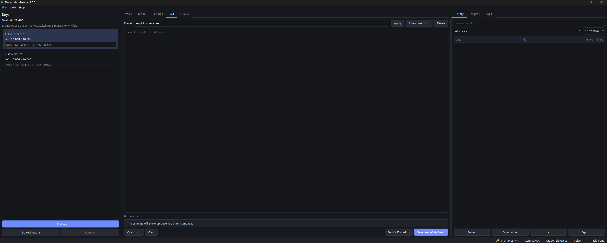
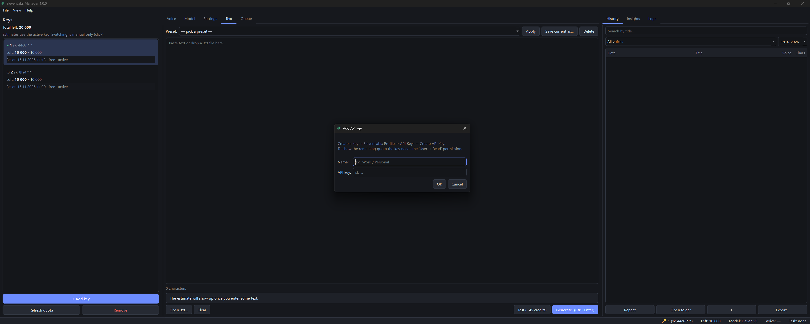
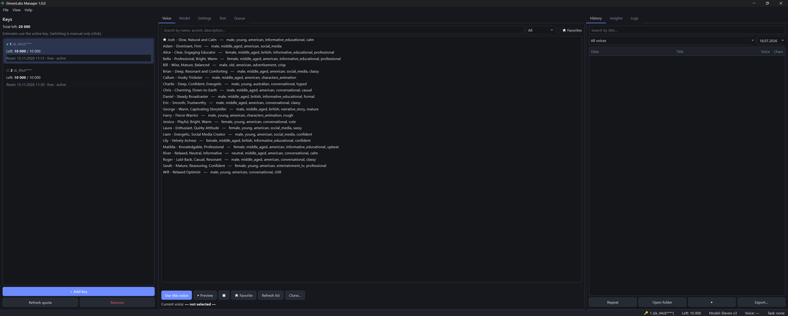

# ElevenLabs Manager

A desktop app for turning long texts into speech with the ElevenLabs API.

I built it because generating an audiobook chapter through the website is painful: you hit the
character limit halfway through, lose track of which part you were on and end up stitching mp3s
by hand. This app splits the text into parts, voices them one by one, glues them into a single
file, and if your quota runs out mid-way it just pauses. Come back after the quota resets (or
switch to another key you own), hit **Continue**, and it picks up from the exact part where it stopped.



## What it does

- Splits text at paragraph and sentence boundaries (knows about "Mr.", "e.g.", "т.е." and friends,
  never cuts a word in half)
- Shows an estimate before you start: credits, number of parts, how many fit into your remaining quota, rough time
- Generates parts one after another and saves progress after every single part
- Pauses instead of failing when the quota is used up, the network drops or the server says 429
- Survives closing the app: on the next launch it offers to continue the unfinished task
- Merges everything into one mp3 (with a small gap between parts, configurable)
- Caches parts, so regenerating the same text with the same settings costs nothing
- Voice browser with search, favorites, previews and instant voice cloning
- History, usage stats, presets, dark/light theme, tray icon, English/Russian UI

What it deliberately does **not** do: rotate keys automatically or try to get around ElevenLabs limits.
If you have several keys (say, a work and a personal workspace), you switch between them yourself.

## Requirements

- Python 3.10 or newer
- ffmpeg (used to merge the parts)
- An ElevenLabs account and API key

## Installation

```bash
git clone https://github.com/frystalfag/elevenlabs-manager.git
cd elevenlabs-manager
python -m venv .venv

# Windows
.venv\Scripts\activate
# macOS / Linux
source .venv/bin/activate

pip install -r requirements.txt
python -m app.main
```

### Installing ffmpeg

| OS | Command |
|---|---|
| Windows | `winget install Gyan.FFmpeg` |
| macOS | `brew install ffmpeg` |
| Ubuntu / Debian | `sudo apt install ffmpeg` |
| Fedora | `sudo dnf install ffmpeg` |
| Arch | `sudo pacman -S ffmpeg` |

Open a new terminal afterwards and check that `ffmpeg -version` works. On Windows you can also skip
PATH entirely and drop `ffmpeg\bin\ffmpeg.exe` next to the app.

If ffmpeg is missing, the app tells you on startup and won't start a generation.

## Getting an API key

1. Log in at [elevenlabs.io](https://elevenlabs.io), open your profile → **API Keys**.
2. Click **Create API Key**. Give it at least *Text to Speech* and *Voices: Read*.
   Add *User: Read* if you want to see your remaining quota in the app, and *Voices: Write* for cloning.
3. Copy the key right away, ElevenLabs only shows it once.

## First run

1. Start the app. It asks you to create a master password. This password locks the app and,
   on systems without a keyring, encrypts your keys. There's no way to recover it, so don't lose it.
2. Click **+ Add key** in the left panel, give it a name and paste the key.
3. The app checks the key and shows how many characters are left and when the quota resets.



Keys are stored in the system keyring (Windows Credential Manager, macOS Keychain, Secret Service on
Linux). If no keyring is available, they go into `data/accounts.enc`, encrypted with your master password.

## Usage

### A short text

1. **Voice** tab → **Refresh list** → pick a voice → **Use this voice**. The ▶ button plays a preview.
2. **Model** tab → Multilingual v2 is a good default for long-form content.
3. **Settings** tab → tweak stability, speed, etc. if you want. **Test** voices a short phrase (~45 credits).
4. **Text** tab → paste your text or drag a `.txt` file into the window. The estimate updates as you type.
5. Press **Ctrl+Enter**, check the plan, click **Generate**.
6. When it's done you'll get a notification with "Open file" / "Show in folder".



### A long text that doesn't fit into your quota

Say you have a 42,000 character chapter and 28,000 characters left on your key.

1. Paste the text. The estimate says something like *"Enough for 14 of 21 parts"*.

   

2. Click **Generate**. After part 14 the task switches to **Paused: quota used up**, you get a
   notification and the tray icon turns blue.

   

3. Now either:
   - wait for the quota to reset. You can close the app; next time you open it, it asks
     whether to continue the unfinished task, or
   - pick another key of yours in the left panel and click **Continue** on the **Queue** tab.
4. Generation resumes from part 15. When the last part is done, everything gets merged into one mp3.

If a part fails because of a server error (5xx, even after 3 retries), the task keeps going and
offers **Retry failed** at the end. **Merge now** glues together whatever is already done.

### Cloning a voice

**Voice** tab → **Clone…** → name, 1–25 clean recordings of one voice (a minute or more in total),
tick the consent box → OK. Your plan needs to include Instant Voice Cloning. Please only clone your
own voice or one you have permission to use.

### Presets

On the **Text** tab, **Save current as…** stores the voice, model and all settings under a name.
**Ctrl+P** opens the preset list. Presets live in `data/presets.json`.

## Keyboard shortcuts

| Keys | Action |
|---|---|
| Ctrl+Enter | Generate |
| Ctrl+P | Presets |
| Ctrl+H | History |
| Ctrl+1 … Ctrl+5 | Switch tabs |
| Esc | Pause (the current part finishes first) |
| Ctrl+L | Lock the app |

## Language

The interface is in English by default. Switch to Russian under **View → Language**; the app offers
to restart so the change takes effect.

## Preferences

**File → Preferences** has the rest: theme, output folder, file name template
(`{date}`, `{time}`, `{voice}`, `{model}`, `{index}`, `{title}`), part size, gap between parts,
auto-merge, deleting parts after merging, the chunk cache, auto-lock and update checks.

**File → Export profile** packs keys, presets, history and settings into a zip. Keys inside the archive
are encrypted with a password you choose. The `data/` folder is also backed up once a day into
`data/backups/` (the last 7 are kept).


## Building an .exe

```bash
pip install pyinstaller
pyinstaller build.spec
```

You'll find it in `dist/ElevenManager/`. Put an `ffmpeg\bin\ffmpeg.exe` next to `ElevenManager.exe`
and the whole folder becomes portable. Data is stored in `data/` next to the exe, or in
`%APPDATA%\ElevenManager` if that folder isn't writable.

## Running the tests

```bash
pip install -r requirements-dev.txt
pytest
```

The generation tests use a fake ElevenLabs client, so they don't need a key and don't spend credits.

## Project layout

```
app/
  core/    no UI here: API client, text splitter, planner, generation thread, storage
  ui/      PyQt6 widgets
  utils/   paths, logging, small helpers
  i18n.py  tr() + i18n_ru.py with the Russian strings
tests/     pytest, no network needed
data/      keys, settings, queue.json, history, cache, logs, backups (created on first run)
output/    generated audio, one folder per task
```

The interesting bits are `core/text_splitter.py` (how the text gets split), `core/manager.py`
(the generation loop with pause/resume) and `core/queue.py` (what gets saved after each part).

## FAQ

**It says ffmpeg isn't found but I installed it.**
Open a *new* terminal, since PATH changes don't reach windows that were already open. Or put
`ffmpeg.exe` into `ffmpeg\bin\` next to the app.

**I get 429 errors.**
That's ElevenLabs rate limiting. Short bursts ("too many concurrent requests") are retried
automatically. Otherwise the task pauses, the **Queue** tab shows a countdown, and **Continue** becomes
available when it runs out (or right away if you switch to another key).

**My voice isn't in the list.**
Hit **Refresh list**. Voices from the Voice Library have to be added to your account on the
ElevenLabs website first. Also check the key has the *Voices: Read* permission.

**keyring doesn't work on Linux.**
Headless systems usually don't have Secret Service. The app notices this and falls back to the
encrypted `data/accounts.enc`. On a desktop, installing `gnome-keyring` usually fixes it.

**How do I continue after hitting the limit?**
**Queue** tab → **Continue**. If you closed the app, you'll be asked on the next start. If the quota
hasn't reset yet, the task pauses again straight away. The app checks the remaining quota before
sending anything, so this costs nothing.

**The remaining quota shows "—".**
The key doesn't have the *User: Read* permission. Generation still works, the app just can't tell
how much is left.

## Known limitations

- ElevenLabs limits (characters, request rate, concurrency) are respected, not worked around.
- ffmpeg is required; without it generation is disabled.
- On headless Linux there's no keyring, so keys are stored in the encrypted fallback file.
- PyInstaller needs `collect_all("PyQt6")` (already in `build.spec`), otherwise the exe can't find the Qt platform plugin.
- The cache key includes text, voice, model, format and every setting. But if a voice gets retrained on
  ElevenLabs' side under the same id, the cache will still hand out the old audio. The estimate tells you
  how many parts will come from the cache, and you can turn it off or clear it in Preferences.
- Pausing happens between parts: a request that's already running is allowed to finish, because
  you're billed for it anyway.
- Only mp3 output formats are supported.
- Credit estimates are approximate (characters × the model's cost multiplier); the actual cost comes
  from the API response.

## License

MIT, see [LICENSE](LICENSE).
